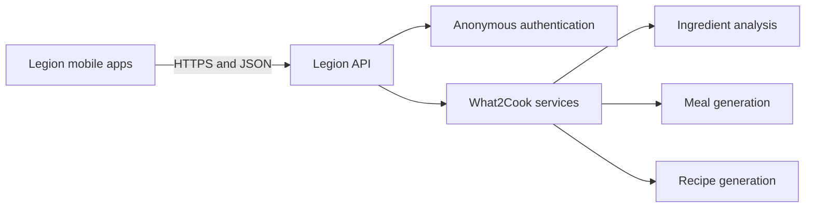

# Legion API

Legion API is the shared backend platform for Legion Apps. It provides reusable
application services behind a single HTTPS interface while keeping backend
source code and infrastructure configuration private.

- **Live API:** [api.legionapps.fun](https://api.legionapps.fun/)
- **Interactive documentation:** [Swagger UI](https://api.legionapps.fun/docs) · [ReDoc](https://api.legionapps.fun/redoc)



## Public services

The currently published OpenAPI schema exposes the following capabilities:

| Method | Endpoint | Purpose |
| --- | --- | --- |
| `POST` | `/auth/anonymous` | Starts an anonymous client session |
| `POST` | `/what2cook/analyze-ingredients` | Extracts ingredient names from submitted images |
| `POST` | `/what2cook/generate-meals` | Suggests meals from an ingredient list and optional request |
| `POST` | `/what2cook/generate-recipe` | Produces required ingredients, quantities, and cooking instructions |
| `GET` | `/health` | Reports service availability |
| `GET` | `/robots.txt` | Publishes crawler guidance |

## What2Cook workflow

1. The client submits one or more ingredient images.
2. The API returns a normalized ingredient list.
3. The user reviews the list and can add or remove items.
4. The API suggests meals using the confirmed ingredients.
5. The selected meal is expanded into quantities and step-by-step instructions.

## Health check

```bash
curl https://api.legionapps.fun/health
```

```json
{"status":"ok","service":"legion-api"}
```

## Platform details

- HTTPS JSON API
- OpenAPI 3.1 schema
- FastAPI service layer
- Cloudflare edge delivery
- Shared backend designed for multiple Legion Apps products

## Repository scope

This public repository is a product and architecture showcase. Backend source,
deployment configuration, provider credentials, internal routes, and operational
documentation are maintained privately.

## License

Copyright 2026 Paul Szyburski. All rights reserved. See [LICENSE](LICENSE).
